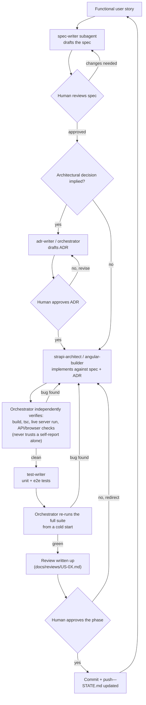

# FLOW — the agentic flow, step by step

This document explains the actual flow used to take the three functional user stories
to QA-ready code — not a plan written in advance, but a record of what really happened,
assembled from `docs/STATE.md` (the append-only decision log kept live throughout the
project) and the git history.

## Tool choice

**Claude Code**, for three concrete reasons specific to this test's requirements:

1. **Subagents are first-class, versioned project files.** `.claude/agents/*.md`
   definitions (instructions, allowed tools) live in the repo itself, are reviewable in
   a PR, and are *actually invocable* — not just documentation describing an idea. This
   directly satisfies the "subagent definitions are versioned in the repository"
   requirement rather than approximating it.
2. **Skills work the same way.** `.claude/skills/project-conventions/SKILL.md` is a real,
   loadable skill (templates for specs/ADRs/reviews), not a prompt fragment copy-pasted
   into every agent. A second skill, `.claude/skills/verification-first/SKILL.md`, was
   added during post-delivery iteration once it was clear the project's single most
   consequential process lesson — never trust a subagent's self-report alone — was worth
   capturing as reusable project knowledge, not just repeated ad-hoc practice.
3. **Sessions are inspectable and exportable.** Every subagent run's full transcript is
   saved locally and can be exported unedited (`logs/`), which is an explicit deliverable
   of this test — this is what let the orchestrator catch a stalled agent reporting false
   progress (see "what didn't work," below) by actually watching what it was doing.

## Spec-Driven Development, own variant

The project follows a lightweight SDD loop rather than an off-the-shelf framework (Spec
Kit, Kiro): **user story → spec → ADR (only if an architectural decision is implied) →
implementation → tests → review → traceability entry**, enforced as a literal rule in
`CLAUDE.md` ("no implementation starts before its spec is approved"). A full framework
felt like more process than three user stories and one small team (one orchestrator, one
human) needed; the same five gates, kept as explicit conventions in one file everyone
(agent or human) reads first, were enough to get the traceability and rigor the test asks
for without the overhead of adopting an external tool's conventions and folder structure.

## Flow diagram

This loop ran once per phase (scaffolding, each ADR, each of the three stories, testing,
Docker, review consolidation) — not once for the whole project. Every arrow in this
diagram happened for real, more than once, including the "bug found" loop-backs.

## Step-by-step table

| Step | Description | AI used? | AI/agent/skill used | Deliverable produced | Human in the loop |
|---|---|---|---|---|---|
| 0. Scaffolding | Project conventions, 7 subagent definitions, 1 skill, and the live decision log were set up before any feature work | Yes | Claude Code (orchestrator) | `CLAUDE.md`, `.claude/agents/*.md`, `.claude/skills/project-conventions/`, `docs/STATE.md` | User asked to start; reviewed the resulting scaffolding before the first ADR |
| 1. Multi-country ADR | Content-differentiation strategy (explicit `country` field vs. Strapi i18n vs. per-country schemas) proposed and decided | Yes | Claude Code (orchestrator, `adr-writer` role) | `docs/adr/0001-multi-country-content-strategy.md` | **User explicitly approved** ("apruebo el adr-0001") before any Strapi/Angular work began — this decision gates everything downstream |
| 2. Specs US-01/02/03 | Three user stories turned into verifiable specs in parallel | Yes | 3× `spec-writer` subagent (parallel) | `specs/US-01/02/03-*.md` | User answered 3 concrete open questions via a structured choice (pricing formula, payment-failure mechanism, empty-plan copy); orchestrator resolved the rest and the user approved the consolidated result |
| 3. Reserved-key ADR | Reconciling US-01's fully dynamic form with US-02/US-03's need for specific semantic fields, discovered while reconciling the three specs | Yes | Claude Code (orchestrator) | `docs/adr/0002-dynamic-form-rendering.md` | **User explicitly approved** before Strapi seed data was built against it |
| 4. Strapi content-types, permissions, seed | `form-field`/`plan`/`terms-and-condition` content-types, Public-role read-only permissions, CO/CL seed data | Yes | `strapi-architect` subagent | `apps/cms/**` | Orchestrator independently verified against the live database and API (the agent's own self-report was unreliable — see "what didn't work"); found and fixed a real TS compile bug before the user ever saw it |
| 5. Angular base scaffolding | Standalone routing shell, `CountryStore`/`WizardStore`, `CountryContentService` | Yes | `angular-builder` subagent | `apps/web/**` (core) | Orchestrator re-verified the build and the live API shape itself (the real Strapi 5 response turned out to be flatter than the specs assumed — corrected the specs, not just the code) |
| 6. US-01 implementation | Dynamic reactive form built from live Strapi config | Yes | `angular-builder` subagent | `quote-form-page/*` | Orchestrator verified live in the browser; approved after the agent's own `computed()`-vs-mutable bug fix was double-checked |
| 7. US-02 implementation | Plan list + simulated pricing rule | Yes | `angular-builder` subagent | `quote-plans-page/*`, `core/pricing/*` | Orchestrator independently re-ran the hand-calculated pricing example and re-verified live in the browser |
| 8. US-03 implementation | Summary, masking, simulated payment | Yes | `angular-builder` subagent | `quote-summary-page/*`, `core/formatting`, `core/payment`, `core/services/simulated-payment.service.ts` | Agent flagged a real UX bug (un-checkable terms checkbox) instead of hiding it; orchestrator fixed it. Live walkthrough was blocked by a disconnected browser tool on **both** the agent's and the orchestrator's side — closed later by Phase 10's e2e suite instead of being silently skipped |
| 9. Accessibility/responsive/security audit | Cross-cutting review of everything built so far | Yes | Claude Code (orchestrator directly — reviewing existing code, not new feature work) | `docs/reviews/non-functional-checklist.md` | User received the findings (2 small polish gaps found and fixed) and moved the project forward |
| 9.5 Payment-rejection UX reconsidered | User asked whether a real UI control (vs. a test-only mock) would better cover "all options"; orchestrator recommended it and the user approved | Yes (discussion) + implementation | Claude Code (orchestrator) | "Simulate a declined payment" button, `SimulatedPaymentService.submitPayment(..., simulateFailure)` | **User-initiated redirection** — this is the clearest example of the human correcting the flow's own prior decision, not just approving it |
| 10. Testing | 11 unit spec files (67 tests) + 3 Playwright e2e specs | Yes | `test-writer` subagent | `apps/web/**/*.spec.ts`, `e2e/**` | Orchestrator re-ran both suites from a cold start independently; a real timezone bug (UTC date parsing) found by the agent while writing a boundary test was independently confirmed and traced to its root cause |
| 11. Docker Compose | Single-command startup for both services, seeded automatically | Yes | Claude Code (orchestrator directly — cross-cutting infra, no single subagent role fit) | `docker-compose.yml`, both `Dockerfile`s | Orchestrator actually ran `docker compose up --build` (had to start Docker Desktop first) and verified the containerized seed/permissions/SPA routing live, not just wrote the files |
| 12. Review consolidation & traceability | Every real finding from Phases 4-10 written up in the project's standard review format | Partially | Claude Code (orchestrator — consolidating review work that already happened live, not a fresh pass) | `docs/reviews/*.md`, `docs/traceability.md` | User reviewed the phase summary and approved moving to Phase 13 |
| 13. FLOW.md / README.md / logs | This document, the run instructions, and the agent session logs | Yes | Claude Code (orchestrator) | `FLOW.md`, `README.md`, `logs/` | **User made a privacy call twice**: first choosing to include unedited logs, then — once told the repo is public, not private as assumed — choosing to include only the subagent logs and exclude the main session log (which contains personal account information). This is documented, not silently decided |

## What would change with a team of 5 developers

- **Per-story ownership instead of one orchestrator reviewing everything serially.**
  Here, one orchestrator was the sole gate for every subagent's output — that doesn't
  scale past a handful of parallel stories. With 5 people, each would own a story (or a
  slice of infra) and run their own `angular-builder`/`strapi-architect` instance, with a
  shared `code-reviewer` subagent cross-checking across people rather than one person
  reading every diff.
- **Branches and PRs instead of direct commits to `master`.** Everything here landed
  directly on `master` because there was exactly one active line of work at a time. Five
  people working stories in parallel need branch-per-story and PR review — which also
  gives a natural home for "evidence of code reviews... PR comments," closer to the
  literal wording of the test than this project's `docs/reviews/*.md` files.
- **CI as the first-pass gate, not a human running `ng test`/`playwright test` by hand
  every time.** Every verification in this project was run manually (`tsc`, `ng build`,
  `ng test`, `playwright test`, `docker compose up`) because there was no other option
  with one person. That doesn't scale to 5 people each spawning agents — a GitHub Actions
  pipeline running the same commands on every PR would need to be the first gate, with
  human/agent review focused on *what* changed rather than *whether it builds*.
- **`docs/STATE.md` as a single append-only file becomes a bottleneck.** One file that
  every phase appends to works for one writer. Five people writing to it concurrently is
  a merge-conflict magnet — it would need to split per area (or move into a lightweight
  issue tracker) while keeping the same "decision + why" discipline.

## What didn't work as expected, and how it was adjusted

- **`strapi-architect` reported progress that wasn't true.** Twice, it sent an "idle,
  waiting on a monitor" status without ever delivering the final report its task asked
  for — meanwhile the underlying work (content-types, permissions, seed) had, in fact,
  already finished successfully. The adjustment: stop waiting on the self-report and
  verify directly against the running database and live API instead. This single
  incident is the reason every subsequent phase in this project was independently
  re-verified rather than taken on an agent's word — it's the most consequential
  adjustment made during the whole flow.
- **The Claude-in-Chrome browser connection dropped mid-project** (it worked for Phases
  6-7, then disconnected for Phase 8 onward, surviving neither a Chrome restart nor a
  session restart). The adjustment: rely on Playwright's e2e suite for live verification
  instead, since it drives its own browser independent of that extension — this is why
  Phase 10 explicitly closes a verification gap Phase 8/9 had to leave open.
- **A real, subtle timezone bug slipped past implementation and initial review.**
  `new Date('YYYY-MM-DD')` parses as UTC midnight, which silently shifts the calendar
  date backward a day in any timezone behind UTC — including both of this project's
  target countries. It wasn't caught until `test-writer` wrote a boundary unit test for
  "one day short of 18." The adjustment wasn't to the flow itself — it's validation that
  the instruction to test exact boundaries, not just happy paths, was doing its job; the
  bug was fixed immediately (`core/formatting/parse-date-only.ts`) once found.
- **One already-approved resolution turned out to be the wrong call and was reversed.**
  Phase 8 decided payment rejection should only be reachable via a test-level mock, to
  avoid "dev-only UI clutter." On reflection (prompted by the user explicitly asking to
  "cover all options"), that reasoning didn't hold up: the whole payment step is already
  an explicitly simulated mock gateway, so a labeled simulation control isn't clutter —
  and without one, a human reviewer manually testing the app could never see that
  acceptance criterion work at all. The resolution was reversed mid-flow (not quietly
  patched over), with the reversal and its reasoning recorded in the spec itself.

## Where AI was deliberately not used

- **Confirming Strapi's Public-role permissions and auditing for leaked tokens.** These
  are binary, high-stakes security checks (write access granted or not; a token present
  or not) where the right move is reading the primary source directly — querying the
  database, grep-ing the actual bundled code — rather than asking another layer of AI
  to characterize it. Verified directly in Phases 4 and 9.
- **Deciding on the three load-bearing ADRs and the payment-rejection UX reversal.**
  `adr-writer`/subagents can draft and propose, but each of these was a real trade-off
  with no objectively-correct answer (how to model country, how to bridge a dynamic form
  with code that needs specific fields, whether a test-only control is "clutter" or an
  honest simulation) — decided jointly by the orchestrator and the human, never shipped
  on a subagent's own say-so, per `CLAUDE.md`'s explicit human-in-the-loop checkpoints.
- **Whether a stalled agent's "it's done" self-report was actually true.** When
  `strapi-architect` stalled, the question was "is this specific, checkable claim true,"
  which direct empirical verification (SQL queries, live HTTP calls) answers more
  reliably than asking another AI to assess it.
- **Reading and handling sensitive local system state.** Diagnosing a DNS/TLS error
  during a `git push` meant reading the Windows `hosts` file and DNS configuration —
  done directly via system tools, with the findings reported to the human for a decision,
  rather than delegated to an agent or acted on unilaterally.
- **The repo's privacy-sensitive decisions** (which session logs to include, given one
  contains personal account information and the repo turned out to be public, not
  private as first assumed) were put to the user explicitly, twice, rather than decided
  on their behalf in either direction.
