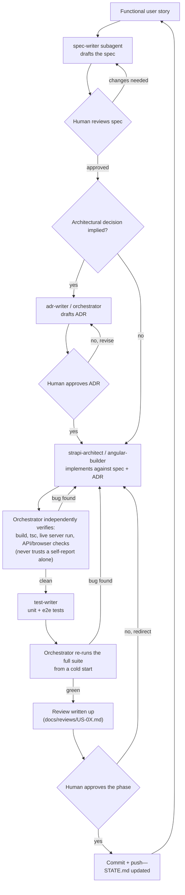

# FLOW — the agentic flow, step by step

This document explains the actual flow used to take the three functional user stories
to QA-ready code — not a plan written in advance, but a record of what really happened,
assembled from `docs/STATE.md` (the append-only decision log kept live throughout the
project) and the git history.

## Tool choice

**Claude Code**, for three concrete reasons specific to this test's requirements:

1. **Subagents are first-class, versioned project files.** `.claude/agents/*.md`
   definitions (instructions, allowed tools) live in the repo itself, are reviewable in
   a PR, and are *actually invocable* — not just documentation describing an idea. This
   directly satisfies the "subagent definitions are versioned in the repository"
   requirement rather than approximating it.
2. **Skills work the same way.** `.claude/skills/project-conventions/SKILL.md` is a real,
   loadable skill (templates for specs/ADRs/reviews), not a prompt fragment copy-pasted
   into every agent. A second skill, `.claude/skills/verification-first/SKILL.md`, was
   added during post-delivery iteration once it was clear the project's single most
   consequential process lesson — never trust a subagent's self-report alone — was worth
   capturing as reusable project knowledge, not just repeated ad-hoc practice.
3. **Sessions are inspectable and exportable.** Every subagent run's full transcript is
   saved locally and can be exported unedited (`logs/`), which is an explicit deliverable
   of this test — this is what let the orchestrator catch a stalled agent reporting false
   progress (see "what didn't work," below) by actually watching what it was doing.

## Spec-Driven Development, own variant

The project follows a lightweight SDD loop rather than an off-the-shelf framework (Spec
Kit, Kiro): **user story → spec → ADR (only if an architectural decision is implied) →
implementation → tests → review → traceability entry**, enforced as a literal rule in
`CLAUDE.md` ("no implementation starts before its spec is approved"). A full framework
felt like more process than three user stories and one small team (one orchestrator, one
human) needed; the same five gates, kept as explicit conventions in one file everyone
(agent or human) reads first, were enough to get the traceability and rigor the test asks
for without the overhead of adopting an external tool's conventions and folder structure.

## Flow diagram

This loop ran once per phase (scaffolding, each ADR, each of the three stories, testing,
Docker, review consolidation) — not once for the whole project. Every arrow in this
diagram happened for real, more than once, including the "bug found" loop-backs.

## Step-by-step table

| Step                                       | Description                                                                                                                                     | AI used?                          | AI/agent/skill used                                                                                 | Deliverable produced                                                                                    | Human in the loop                                                                                                                                                                                                                                                                                              |
| ------------------------------------------ | ----------------------------------------------------------------------------------------------------------------------------------------------- | --------------------------------- | --------------------------------------------------------------------------------------------------- | ------------------------------------------------------------------------------------------------------- | -------------------------------------------------------------------------------------------------------------------------------------------------------------------------------------------------------------------------------------------------------------------------------------------------------------- |
| 0. Scaffolding                             | Project conventions, 7 subagent definitions, 1 skill, and the live decision log were set up before any feature work                             | Yes                               | Claude Code (orchestrator)                                                                          | `CLAUDE.md`, `.claude/agents/*.md`, `.claude/skills/project-conventions/`, `docs/STATE.md`              | User asked to start; reviewed the resulting scaffolding before the first ADR                                                                                                                                                                                                                                   |
| 1. Multi-country ADR                       | Content-differentiation strategy (explicit `country` field vs. Strapi i18n vs. per-country schemas) proposed and decided                        | Yes                               | Claude Code (orchestrator, `adr-writer` role)                                                       | `docs/adr/0001-multi-country-content-strategy.md`                                                       | **User explicitly approved** ("apruebo el adr-0001") before any Strapi/Angular work began — this decision gates everything downstream                                                                                                                                                                          |
| 2. Specs US-01/02/03                       | Three user stories turned into verifiable specs in parallel                                                                                     | Yes                               | 3× `spec-writer` subagent (parallel)                                                                | `specs/US-01/02/03-*.md`                                                                                | User answered 3 concrete open questions via a structured choice (pricing formula, payment-failure mechanism, empty-plan copy); orchestrator resolved the rest and the user approved the consolidated result                                                                                                    |
| 3. Reserved-key ADR                        | Reconciling US-01's fully dynamic form with US-02/US-03's need for specific semantic fields, discovered while reconciling the three specs       | Yes                               | Claude Code (orchestrator)                                                                          | `docs/adr/0002-dynamic-form-rendering.md`                                                               | **User explicitly approved** before Strapi seed data was built against it                                                                                                                                                                                                                                      |
| 4. Strapi content-types, permissions, seed | `form-field`/`plan`/`terms-and-condition` content-types, Public-role read-only permissions, CO/CL seed data                                     | Yes                               | `strapi-architect` subagent                                                                         | `apps/cms/**`                                                                                           | Orchestrator independently verified against the live database and API (the agent's own self-report was unreliable — see "what didn't work"); found and fixed a real TS compile bug before the user ever saw it                                                                                                 |
| 5. Angular base scaffolding                | Standalone routing shell, `CountryStore`/`WizardStore`, `CountryContentService`                                                                 | Yes                               | `angular-builder` subagent                                                                          | `apps/web/**` (core)                                                                                    | Orchestrator re-verified the build and the live API shape itself (the real Strapi 5 response turned out to be flatter than the specs assumed — corrected the specs, not just the code)                                                                                                                         |
| 6. US-01 implementation                    | Dynamic reactive form built from live Strapi config                                                                                             | Yes                               | `angular-builder` subagent                                                                          | `quote-form-page/*`                                                                                     | Orchestrator verified live in the browser; approved after the agent's own `computed()`-vs-mutable bug fix was double-checked                                                                                                                                                                                   |
| 7. US-02 implementation                    | Plan list + simulated pricing rule                                                                                                              | Yes                               | `angular-builder` subagent                                                                          | `quote-plans-page/*`, `core/pricing/*`                                                                  | Orchestrator independently re-ran the hand-calculated pricing example and re-verified live in the browser                                                                                                                                                                                                      |
| 8. US-03 implementation                    | Summary, masking, simulated payment                                                                                                             | Yes                               | `angular-builder` subagent                                                                          | `quote-summary-page/*`, `core/formatting`, `core/payment`, `core/services/simulated-payment.service.ts` | Agent flagged a real UX bug (un-checkable terms checkbox) instead of hiding it; orchestrator fixed it. Live walkthrough was blocked by a disconnected browser tool on **both** the agent's and the orchestrator's side — closed later by Phase 10's e2e suite instead of being silently skipped                |
| 9. Accessibility/responsive/security audit | Cross-cutting review of everything built so far                                                                                                 | Yes                               | Claude Code (orchestrator directly — reviewing existing code, not new feature work)                 | `docs/reviews/non-functional-checklist.md`                                                              | User received the findings (2 small polish gaps found and fixed) and moved the project forward                                                                                                                                                                                                                 |
| 9.5 Payment-rejection UX reconsidered      | User asked whether a real UI control (vs. a test-only mock) would better cover "all options"; orchestrator recommended it and the user approved | Yes (discussion) + implementation | Claude Code (orchestrator)                                                                          | "Simulate a declined payment" button, `SimulatedPaymentService.submitPayment(..., simulateFailure)`     | **User-initiated redirection** — this is the clearest example of the human correcting the flow's own prior decision, not just approving it                                                                                                                                                                     |
| 10. Testing                                | 11 unit spec files (67 tests) + 3 Playwright e2e specs                                                                                          | Yes                               | `test-writer` subagent                                                                              | `apps/web/**/*.spec.ts`, `e2e/**`                                                                       | Orchestrator re-ran both suites from a cold start independently; a real timezone bug (UTC date parsing) found by the agent while writing a boundary test was independently confirmed and traced to its root cause                                                                                              |
| 11. Docker Compose                         | Single-command startup for both services, seeded automatically                                                                                  | Yes                               | Claude Code (orchestrator directly — cross-cutting infra, no single subagent role fit)              | `docker-compose.yml`, both `Dockerfile`s                                                                | Orchestrator actually ran `docker compose up --build` (had to start Docker Desktop first) and verified the containerized seed/permissions/SPA routing live, not just wrote the files                                                                                                                           |
| 12. Review consolidation & traceability    | Every real finding from Phases 4-10 written up in the project's standard review format                                                          | Partially                         | Claude Code (orchestrator — consolidating review work that already happened live, not a fresh pass) | `docs/reviews/*.md`, `docs/traceability.md`                                                             | User reviewed the phase summary and approved moving to Phase 13                                                                                                                                                                                                                                                |
| 13. FLOW.md / README.md / logs             | This document, the run instructions, and the agent session logs                                                                                 | Yes                               | Claude Code (orchestrator)                                                                          | `FLOW.md`, `README.md`, `logs/`                                                                         | **User made a privacy call twice**: first choosing to include unedited logs, then — once told the repo is public, not private as assumed — choosing to include only the subagent logs and exclude the main session log (which contains personal account information). This is documented, not silently decided |

## What would change with a team of 5 developers

### 1.1 Per-story ownership instead of a single orchestrator reviewing everything sequentially

In this project, a single orchestrator was responsible for approving every subagent's
output, centralizing decision-making, and coordinating the workflow — telling each
subagent what to do and where to direct its work.

This approach works with a small number of user stories and a single person driving
development, but it doesn't scale well once several stories are being worked on in
parallel.

With a team of five developers, each person could own a user story or a specific slice
of the infrastructure, managing their own specialized agents for development.

Additionally, a shared subagent — a `Core Reviewer`, the same kind of role already used
in this project — could be introduced to perform cross-checks between team members,
instead of relying on a single person to review every change made to the code.

### 1.2 Using branches and Pull Requests instead of committing directly to the master branch

In this project, every change was merged directly into `master`, because there was only
one active line of work and one person doing all the development. For that reason,
working this way never caused problems.

However, once five people are working simultaneously on different user stories, an
independent-branch strategy is necessary — ideally one branch per user story.

This would keep each person's work isolated, preventing one person's changes from
interfering with another's, and reducing the chance of conflicts, mistakes, or accidental
edits to functionality that is still in progress.

It would also be necessary to use Pull Requests, so every change goes through a review
process before being merged into the main branch. That gives much more control over what's
being built and ensures changes are aligned before they're integrated.

### 1.3 Introducing CI as the first validation filter

Right now, the team is a single person responsible for all the development and for running
every verification manually.

That means going into the project and running commands like `tsc`, `ng build`, `ng test`,
`playwright test`, and so on, to confirm that the changes made aren't breaking anything and
that the project still works correctly.

This process is manual because, with only one person working, there was no other option
within the workflow that was implemented.

However, with five developers working simultaneously, the right move would be to set up a
continuous integration (CI) pipeline — GitHub Actions or Azure Pipelines — that
automatically runs these same checks every time a Pull Request is opened.

That would save time, cut down on repetitive work, and guarantee that every change passes
a first validation filter before it ever reaches a human reviewer.

## What didn't work as expected, and how it was adjusted

### 2.1 Incorrect progress reports from the Strapi Architect subagent

During development we ran into an issue with one of the agents, specifically
`Strapi Architect`, which on several occasions reported progress that didn't match the
actual state of the work.

On different occasions the agent sent messages saying it had finished its assigned tasks,
or that the tests had completed successfully and all of them had passed, when that wasn't
actually true.

This could have been caused by a number of things — unhandled errors, connection
failures, network issues, or other problems that led the agent to misinterpret the result
of its own execution and report that everything had finished correctly.

**How was it fixed?**

We had to add a new rule to the workflow: when a subagent finishes a task, it must notify
the orchestrator so the orchestrator can independently review all the work that was done.

If any anomaly is found, the orchestrator has to notify the subagent again so it can make
the corresponding corrections and re-run its checks.

This process repeats until both the subagent and the orchestrator reach an approved state
for the work done. Only after both of those checks pass does the development reach my own
review, where I do a final check and give the go-ahead to proceed with `commit` and `push`
to the repository.

### 2.2 A bug related to date and timezone handling

During development we also found a real, fairly subtle bug related to timezone handling.

When you use `new Date('YYYY-MM-DD')`, JavaScript interprets that date as midnight UTC.
That can make the calendar date roll back one day in any timezone behind UTC — which is
exactly what happens in both of this project's target countries: Colombia and Chile.

The fix wasn't a change to the workflow itself, but a reinforcement of the instructions
and validation criteria so that tests would cover the exact boundaries of each scenario.

In other words, we couldn't limit ourselves to testing only the successful scenarios —
known technically as happy paths — we also needed to cover the different possible
scenarios, especially the ones sitting right at the edge of the established conditions.

Once the source of the problem was identified, the corresponding fix was made and verified
again.

### 2.3 An already-approved decision turned out to be wrong and had to be reverted

During Phase 8 of development, the decision was made that a declined payment could only be
tested via a test-level `mock`, in order to avoid adding what was considered an unnecessary
element to the development interface.

However, after reconsidering that decision, it became clear the original approach needed
to change.

The payment flow already worked through a simulated gateway, so we decided to add a visual
control that let someone select the declined-payment option and verify that part of the
flow worked correctly.

This mattered because, beyond the automated tests, we needed a person to be able to go into
the application and visually verify this scenario's behavior.

The decision took into account that this was entirely simulated information and processes,
so there was no issue with adding this control to the test environment.

In the end, the original decision was reverted, and the alternative that properly covered
this acceptance criterion was implemented instead.

## Where AI was deliberately not used

### 3.1 Verifying role permissions and auditing for leaked tokens

These are critical, binary-outcome security checks: a write permission is either enabled
or it isn't, and a token either exists or it doesn't.

In these cases, the right call was to check the primary sources of information directly,
instead of asking another AI layer, another subagent, or another agent to interpret or
describe the situation.

For that reason, these checks were done directly by a person — in this case, me —
querying the database and reviewing the compiled code to identify the existing permissions
and confirm there was no leaked sensitive information.

These reviews were carried out during Phases 4 and 9 of the project and made it possible
to directly confirm the state of Strapi's public role permissions, giving the agent
reliable information to base its development decisions on.

### 3.2 Making the three fundamental ADR-documented decisions, and reverting the payment-rejection UX decision

The `ADR Writer` agent and the other subagents can draft documents, analyze alternatives,
and propose solutions. However, some of this project's decisions involved genuine
trade-offs with no objectively correct answer.

For example:

- How to represent and model the different countries within the application.
- How to connect a dynamic form to code that needs to receive specific fields in order to
  work correctly.
- Whether adding a test-only control is an unnecessary element in the interface, or
  whether it instead allows for a transparent simulation and lets the system's behavior be
  properly verified.

These decisions were analyzed and made jointly between the orchestrator and a person — in
this case, me.

A subagent was never allowed to make these decisions autonomously and implement them
without prior review. Every alternative was evaluated, its implications were analyzed, and
in the end the decision considered most appropriate for the project was made.

### 3.3 Checking whether a stalled agent's claim of being "done" was actually true

As mentioned earlier, we had a subagent called `Strapi Architect` that, more than once,
stopped responding correctly or reported a status that didn't match the work it had
actually done.

In those cases, the questions were fairly concrete:

- Did the development actually finish?
- Were all the assigned tasks completed?
- Were the tests run?
- Did all the tests pass correctly?
- Is the code complete and working correctly?

The problem was that the agent answered these questions affirmatively, claiming that
everything was finished and working without issues.

However, when I personally went in to review the work, I found that the reported
information wasn't accurate. There were variations that weren't actually complete yet,
pending functionality, and work that didn't meet what had been requested.

That meant I had to step in directly to check the real state of the project and verify
each of the results myself.

For that reason, we decided not to delegate this verification to another AI. When it's
necessary to determine whether a task is actually finished, whether the tests passed, or
whether the code meets what was requested, the verification has to be done directly
against the result itself — not rely solely on what another agent reports.
  

  
